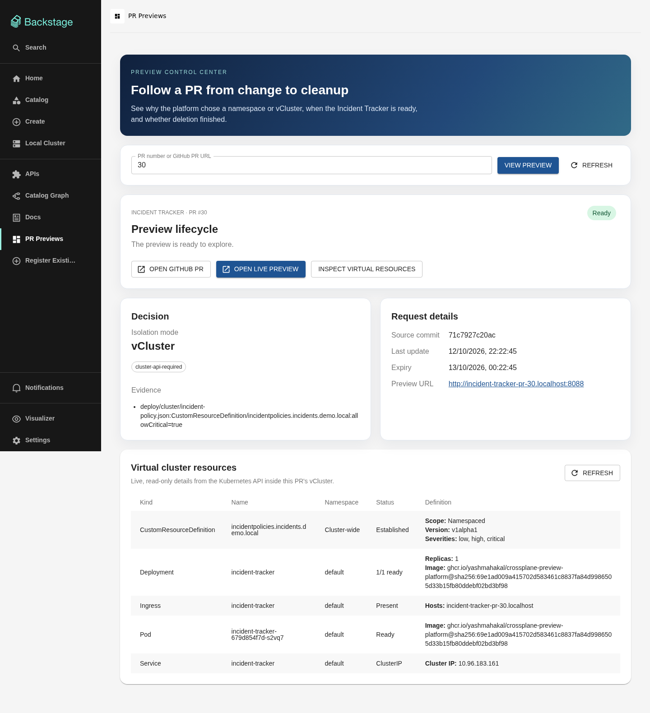
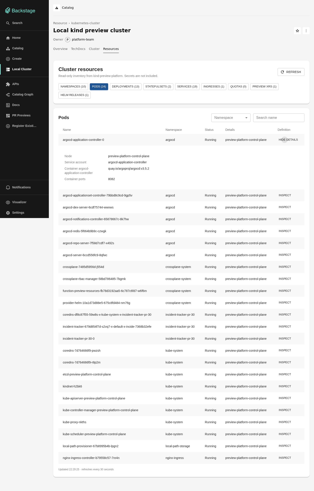

# Backstage vCluster inventory and host definitions — 2026-10-12

Function v0.1.7 [published successfully](https://github.com/YASHMAHAKAL/crossplane-preview-platform/actions/runs/38279974307) and became `Installed=True` and `Healthy=True` on `kind-preview-platform`. It adds a `preview-observer` ServiceAccount, ClusterRole, and ClusterRoleBinding inside each new vCluster. The Go Function and evaluator suites passed with Go 1.25.10, and the Backstage portal TypeScript check passed.

Backstage's IncidentPolicy template opened [disposable PR #30](https://github.com/YASHMAHAKAL/crossplane-preview-platform/pull/30) at head `71c7927c20ac90045e9c00e92427c4beade52b57`. The PR changed only `deploy/cluster/incident-policy.json`. Exact-head image CI passed, and the evaluator selected `vcluster` with `cluster-api-required` evidence. The status API reached `ready` and served `http://incident-tracker-pr-30.localhost:8088`.

The new guest inventory endpoint used the vCluster host Secret to request a ten-minute observer token, then read only allowlisted guest API paths. Its response contained five sanitized resources: an Established IncidentPolicy CRD with severities `low, high, critical`; a `1/1` Incident Tracker Deployment; a Ready app Pod; and the app Service and Ingress. In a signed-in Backstage browser at `http://localhost:3000/previews?pr=30`, the **Virtual cluster resources** panel displayed all five rows with no alerts. The persistent **Local Cluster → Resources** page also expanded a host Pod row to show its node, ServiceAccount, image, and container port. The definitions are curated fields rather than raw Kubernetes manifests.

Guest RBAC checks confirmed `preview-observer` could list Pods and get the IncidentPolicy CRD, but could not list Secrets or create Deployments. The browser received resource summaries; the kubeconfig and token stayed server-side. The trusted local status service still needs host-cluster access to the vCluster Secret to request that scoped guest token, so this remains a single-operator local deployment rather than per-user multi-tenant access.

After PR #30 closed, the status became `cleaning` and the guest inventory endpoint immediately returned HTTP 409. Argo deleted the Application; Crossplane and provider-helm removed the XR, vCluster Release, namespace, and persistent volume. The watcher reached `deleted` with `pr-closed` and `cleanup-verified`. `deploy/local/verify-preview.sh 30 deleted` confirmed the Application, XR, namespace, PV, and route were absent; the guest endpoint continued returning HTTP 409.
